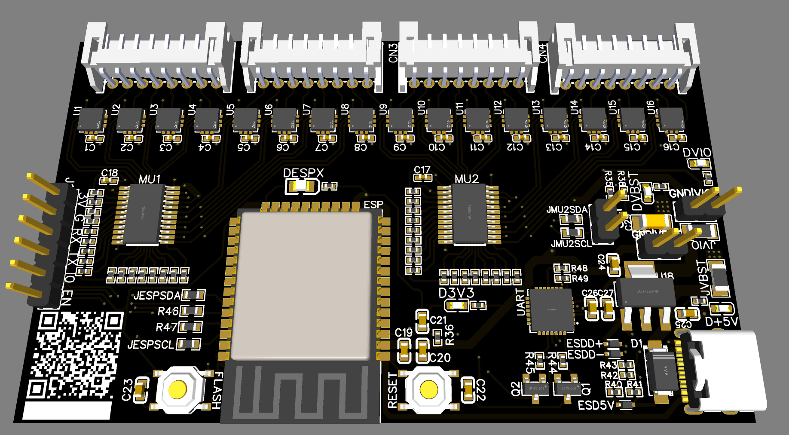

# HapticGlove

USB-C control board for up to 16 linear resonant actuators (LRAs). Can be driven with [AdapTics](https://github.com/AdaptiveHaptics/AdapticsEngine) or custom software using the [serial protocol](https://github.com/kevin-cgc/HapticGlove/blob/main/src/main.cpp#L138-L195) ([example implementation](https://github.com/AdaptiveHaptics/AdapticsEngine/blob/main/adaptics-engine/src/threads/streaming/hapticglove/glovedriver.rs)).

The hardware design is based on the glove described in [HapticPilot](https://doi.org/10.1145/3631453) (Sung et al., 2023).

# Non-PCB Bill of Materials (BOM)

- **1x Stretchy (spandex) gloves**
  e.g. https://www.amazon.com/Sheface-Spandex-Stretchy-Costume-Banquet/dp/B0C53B9TR9

- **4x 8-pin JST PH 2.0mm Ribbon Cable (at least 30cm)**
  For a PCB mounted on the back of the wrist, 30cm length should be sufficient. Consider getting 60cm or longer as then you can use both ends of the connector and trim as needed. https://www.aliexpress.us/item/3256804149637476.html

- **16x Linear Resonant Actuators (LRAs)**
  The default firmware is tuned for the VG1040003D model. Adjust settings in `hapticSettings` if using a different model. https://www.digikey.com/en/products/detail/vybronics-inc/VG1040003D/10285886

---

# Ordering the PCB

If ordering PCB+Assembly through JLCPCB, **DA7280 ICs must be pre-ordered** (typically through global sourcing), which could take 2 weeks or more. The PCBA order cannot begin until these components arrive.

### Notes on Pre-Ordering DA7280 ICs
- Extra "attrition" components *may* be required due to potential manufacturing losses. Double check JLCPCB's attrition calculator or consult their support team to verify the number of units required.

---

# Building the Firmware

This project uses the [PlatformIO](https://platformio.org/) build system.
You can build the project using either:
1. The [PlatformIO IDE (VS Code extension)](https://platformio.org/platformio-ide), or
2. The [PlatformIO CLI](https://docs.platformio.org/en/latest/core/installation.html).

Refer to PlatformIO's documentation for setup instructions.

# Uploading the Firmware and Device Communication
USB to UART drivers are available from Silicon Labs at https://www.silabs.com/developer-tools/usb-to-uart-bridge-vcp-drivers?tab=downloads.

# Assembling the Haptic Glove

### Preparation
- **Use a 3D Hand Model or Mannequin (Optional)**
   - A 3D-printed hand model or mannequin can assist with the placement of the LRAs. The model doesn’t need to be posable, but it should allow the glove to fit snugly for accurate positioning.

- **Position the Wires**
   - Lay out the wires by taping the pigtail ends to the glove in the desired LRA positions.
   - If the connectors are too long, trim one end as needed. This step ensures proper wire lengths before soldering.

### Soldering LRAs

- **Soldering the Pigtails**
  Remove the wires from the glove and solder the pigtails to the LRAs. Strip only 1–2mm of insulation to keep the connections tidy. Make sure to load heat-shrink onto wire before soldering.

- **Wiring Details**
  - **Fingers**:
    Route the wires around the back or opposite side of the pigtails to increase flexibility and reduce interference with hand movements. Secure the wires with thin heat-shrink tubing to prevent extra splitting at the Y-junction.
  - **Palm**:
    I recommend standard "straight-in" wire orientation for LRAs on the palm. This requires applying a larger-diameter heat-shrink tubing over the solder pads to protect and reinforce the connections.

- **Polarity Considerations**
  I aimed to maintain consistent polarity for all LRAs. This meant "flipping" the wire pairs routed to the fingers to the back side (e.g., from the marked-red side to the white side), which actually also helped make the layout more comfortable. While the v1 PCB does not explicitly synchronize phase, this also simplifies future upgrades or modifications.

### Adhering the LRAs
Attach the LRAs to the glove using their pre-applied adhesive. Additional flexible fabric adhesive is recommended.

The LRA positions can be configured in software, so layouts can be flexible and precise placement is not necessary.

# License

[MIT](LICENSE). Third-party libraries retain their original license notices.
